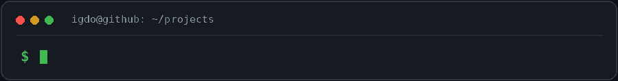

<h1 align="center">Igdo Ragil Manuel</h1>

  Informatics Engineering Student • Machine Learning • Web Development • Software Development

  

  
  
  

---

## Profile

I am an Informatics Engineering student at Universitas Dian Nuswantoro with an interest in machine learning, web development, and software engineering.  
I enjoy building practical systems, experimenting with data-driven solutions, and turning ideas into usable applications.

---

## Focus

- Machine Learning
- Web Development
- Computer Vision
- Natural Language Processing
- API Development
- Software Engineering

---

## Tech Stack

<strong>Programming Languages</strong>

 

<strong>Machine Learning and Data</strong>

 

<strong>Web and Backend</strong>

 

<strong>Tools</strong>

 

---

## GitHub Analytics

  Development activity and languages across my GitHub repositories

  
  

  

<b>Contribution history</b> · animated snake

 

  

Cards refresh daily via GitHub Actions. Language percentages describe repository contents, not skill level.

---

## Current Interests

- Building practical machine learning applications
- Improving model deployment workflows
- Developing web-based systems and tools
- Learning better software engineering practices

---

